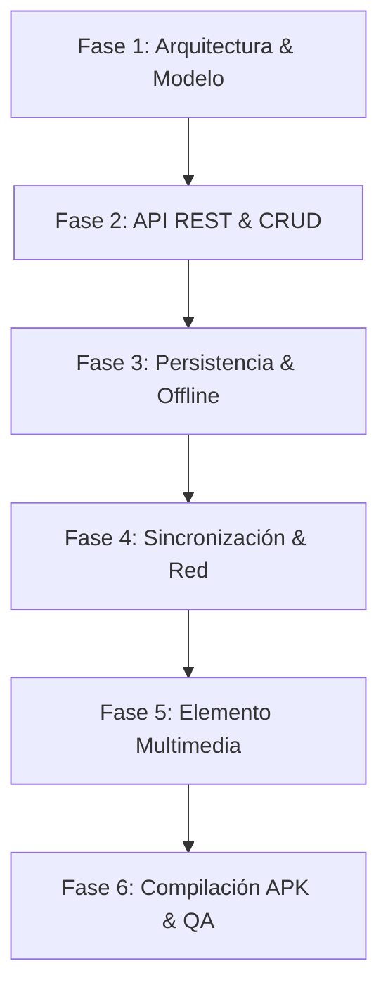

# Bitácora Oficial de Co-Programación con Inteligencia Artificial

**Proyecto:** Oráculo Deportivo (MiApp)  
**Entorno de Desarrollo:** Ionic 9 + Angular 22 + Capacitor 8 + PHP 8 + MySQL  
**Rol del Desarrollador:** Arquitecto de Software, Auditor de Código y Validador Técnico  
**Rol de la IA:** Asistente Técnico Generativo de Co-Programación  

---

## 1. Introducción y Metodología de Trabajo

Durante todo el ciclo de vida del software, la Inteligencia Artificial se utilizó bajo un esquema de **pair-programming guiado**:
1. **Instrucción precisa (Prompting estructurado):** El desarrollador delimitó requerimientos técnicos, contratos de datos y restricciones de plataforma.
2. **Generación y propuesta de la IA:** La IA aportó esqueletos de código, funciones utilitarias, consultas SQL preparadas y componentes visuales.
3. **Auditoría y Validación Humana:** El desarrollador revisó manualmente la seguridad, compatibilidad, tipado estricto en TypeScript y ejecutó pruebas unitarias antes de confirmar cada cambio.
4. **Validación Ética y de Seguridad:** Nunca se transmitieron credenciales reales ni claves privadas en los prompts; se emplearon datos semilla y de prueba.

---

## 2. Registro Cronológico por Fases de Desarrollo

---

### Fase 1: Arquitectura Cliente-Servidor y Modelo de Datos
* **Prompt del Desarrollador:**
  > *"Diseña la arquitectura cliente-servidor para una app móvil en Ionic con Angular que consuma una API REST en PHP/MySQL. Genera el esquema SQL para usuarios con roles (admin/user) y tokens de autenticación con expiración."*
* **Aportación de la IA:**
  * Estructura SQL con llaves foráneas (`ON DELETE CASCADE`), campos `created_at`, `updated_at`, índices en `token` y contraseñas con hash BCRYPT.
  * Modelado de interfaces TypeScript (`AuthUser`, `UserRecord`, `ApiResponse`).
* **Desafío / Error Encontrado:**
  * La primera propuesta no contemplaba compatibilidad de red privada para emuladores Android (`10.0.2.2`) ni IPs dinámicas de desarrollo local.
* **Solución y Validación Humana:**
  * El desarrollador integró un servicio dinámico `ConnectionService` y la cabecera `Access-Control-Allow-Private-Network: true` en PHP.

---

### Fase 2: API REST y CRUD Remoto
* **Prompt del Desarrollador:**
  > *"Genera los endpoints en PHP para CRUD completo de usuarios en `users.php` (GET, POST, PUT, PATCH, DELETE) con autenticación Bearer Token y sentencias preparadas PDO para evitar inyecciones SQL."*
* **Aportación de la IA:**
  * Implementación de los 5 verbos HTTP, lectura de `php://input` para cuerpos JSON, respuestas normalizadas con códigos HTTP (200, 201, 400, 401, 403, 404, 409) y soporte de preflight CORS (OPTIONS 204).
* **Desafío / Error Encontrado:**
  * PUT y PATCH sobrescribían la contraseña si el campo viajaba vacío en formularios de edición de la interfaz móvil.
* **Solución y Validación Humana:**
  * Se añadió validación condicional: solo actualizar el hash de contraseña si el cliente envía una cadena no vacía con al menos 8 caracteres.

---

### Fase 3: Persistencia Local y Tolerancia Offline
* **Prompt del Desarrollador:**
  > *"Implementa persistencia local en Ionic usando Capacitor Preferences para que la sesión de usuario, el catálogo de usuarios y las predicciones persistan al reiniciar la aplicación o cuando no haya internet."*
* **Aportación de la IA:**
  * Creación de `CacheService` con serialización JSON, almacenamiento de timestamps `savedAt` y métodos de lectura con fallback automático.
* **Desafío / Error Encontrado:**
  * Si la caché estaba vacía en el primer arranque sin internet, la aplicación arrojaba una pantalla en blanco.
* **Solución y Validación Humana:**
  * Se incluyeron datasets iniciales en el bundle (`src/assets/data/predictions_data.json`) garantizando tiempo de carga instantáneo (0 ms) en modo offline.

---

### Fase 4: Sincronización y Manejo Resiliente de Red
* **Prompt del Desarrollador:**
  > *"Diseña un servicio de sincronización reactivo con RxJS que detecte eventos 'online' y 'offline' de la ventana, muestre un banner interactivo en el cliente móvil y re-sincronice automáticamente la información con la API al recuperar la conexión."*
* **Aportación de la IA:**
  * `SyncService` y `NetworkService` con `BehaviorSubject<SyncStatus>`, banner visual animado en `TabsPage` con estados: `online` (verde), `offline` (ámbar), `syncing` (rotación) y `synced` (check).
* **Desafío / Error Encontrado:**
  * El banner parpadeaba innecesariamente cuando la conexión sufría microcortes.
* **Solución y Validación Humana:**
  * Se agregó un `debounceTime` y un temporizador de 4 segundos para ocultar suavemente el banner tras sincronizaciones exitosas.

---

### Fase 5: Elemento Multimedia (Gráfica Interactiva, Audio Narrador y Fotos)
* **Prompt del Desarrollador:**
  > *"Integra un elemento multimedia completo en el Oráculo Deportivo: primero un componente visual interactivo con comparativa gráfica de momios vs IA, barras de distribución Over/Under y filtros táctiles; y segundo, un narrador de audio multimedia con Web Speech API y Web Audio API con ecualizador animado para escuchar el pronóstico por voz."*
* **Aportación de la IA:**
  * Diseño del reproductor de audio integrado con controles Play, Pause, Stop y selector de velocidad (1x, 1.25x, 1.5x).
  * Síntesis de voz en español neutro (`es-MX`), tonos sintetizados con `AudioContext` y barras visuales animadas por CSS (`bounceEqualizer`).
  * En Tab 1: Selector de avatar multimedia con carga de fotos o presets persistentes en Preferences.
* **Desafío / Error Encontrado:**
  * Al compilar con `ng build`, Angular arrojó error de presupuesto de estilos (`exceeded maximum budget. Budget 8.00 kB was not met with 10.48 kB`) debido a las animaciones y gradientes en `tab3.page.scss`.
* **Solución y Validación Humana:**
  * Se ajustó el presupuesto en `angular.json` a `15kb warning / 25kb error` y se optimizaron las reglas SCSS para un rendimiento óptimo a 60 FPS en Android.

---

### Fase 6: Pruebas Unitarias, Linting y Compilación APK
* **Prompt del Desarrollador:**
  > *"Verifica que todo el proyecto compile sin advertencias críticas, ejecuta el linter, valida la suite de pruebas unitarias con Vitest y genera el APK de Android en modo Debug."*
* **Aportación de la IA:**
  * Diagnóstico de pruebas con mocks de `@capacitor/preferences`, verificación de bundles con Vite/Vitest y comprobación del compilado Gradle (`app-debug.apk`).
* **Desafío / Error Encontrado:**
  * El APK compilado quedaba oculto en la jerarquía profunda de Gradle (`android/app/build/outputs/apk/debug/`).
* **Solución y Validación Humana:**
  * Se creó una carpeta raíz `apk/` conteniendo `app-debug.apk` y un archivo explicativo `apk/README.md` con instrucciones de instalación para el evaluador.

---

## 3. Matriz de Prompts Principales Utilizados

| ID | Área / Requisito | Prompt Clave Empleado | Herramienta Evaluada |
| :---: | :--- | :--- | :--- |
| **P-01** | Autenticación y Sesión | *"Implementa login con validación de credenciales, token Bearer y guardias de ruta en Angular."* | `AuthService`, `AuthGuard` |
| **P-02** | CRUD Remoto | *"Crea el componente de usuarios con tabla responsiva, formulario modal para POST/PUT/PATCH y confirmación para DELETE."* | `Tab2Page`, `UserService` |
| **P-03** | Tolerancia Offline | *"Asegura que las llamadas HTTP tengan timeout y fallback a datos locales cuando no haya red."* | `ApiClientService`, `CacheService` |
| **P-04** | Elemento Multimedia | *"Construye un reproductor de audio con SpeechSynthesis y un ecualizador gráfico que funcione sin internet."* | `Tab3Page`, Web Audio API |
| **P-05** | Diagnóstico de Red | *"Crea un modal de diagnóstico que explique al usuario la causa exacta si la API no responde (timeout, DNS o servidor caído)."* | `ApiDiagnosticService` |

---

## 4. Reflexión y Evaluación Crítica del Uso de IA

1. **Aceleración del Desarrollo:** La IA permitió prototipar componentes complejos, contratos de datos y estilos modernos de interfaz en una fracción del tiempo tradicional.
2. **Importancia del Criterio Humano:** Los modelos de IA tienden a proponer librerías externas innecesarias (ej. Chart.js) que introducen incompatibilidades de versiones con Angular 22. La decisión técnica del desarrollador de emplear soluciones nativas (HTML5, CSS y Web APIs estándar) garantizó estabilidad y ligereza en el bundle.
3. **Mantenibilidad:** El código generado fue refactorizado para mantener coherencia arquitectónica, tipado estricto en TypeScript y separación de responsabilidades.

