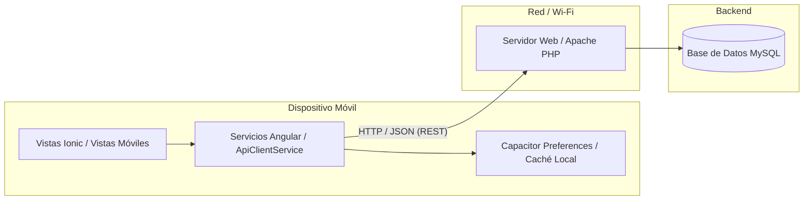

# Arquitectura: Cliente Móvil Conectado a Servicio Web REST

Este documento detalla la conversión y configuración de la aplicación como **cliente móvil** conectado a un **servicio web**, los **modelos JSON de intercambio de información** y los **servicios Angular** preparados para consumir la API.

---

## 1. Cliente Móvil Conectado a Servicio Web

La aplicación funciona como un cliente móvil híbrido y multiplataforma construido sobre **Ionic 9 + Angular 22 + Capacitor 8**, diseñado para consumir servicios web REST (PHP/Apache/MySQL o cualquier backend HTTP/JSON).



### Características del Cliente Móvil:
- **Configuración de Tráfico Claro (Cleartext HTTP)**: Configurado en `capacitor.config.ts` (`server.cleartext: true` y `androidScheme: 'http'`) para permitir comunicación directa con servidores locales o de desarrollo en la red Wi-Fi sin bloqueos del sistema operativo Android/iOS.
- **Configuración Dinámica de IP**: Mediante `ConnectionService`, el cliente móvil permite configurar en caliente la IP del servidor web (por ejemplo `192.168.1.71`) sin necesidad de recompilar la aplicación.
- **Persistencia Local Segura**: Almacenamiento del token de sesión (`Bearer`), el perfil de usuario y la configuración de conexión mediante `@capacitor/preferences`.
- **Resiliencia y Modo Offline**: Soporte de Service Worker y caché local (`CacheService`) para mantener la aplicación operativa si la conexión del dispositivo móvil se interrumpe.

---

## 2. Modelo JSON de Intercambio de Información

Todos los contratos de intercambio de datos se encuentran centralizados en el directorio `src/app/models/`:

### A. Autenticación (`auth.model.ts`)

#### Solicitud de Login (Client → Server)
```json
{
  "username": "admin",
  "password": "password123"
}
```

#### Respuesta de Login (Server → Client)
```json
{
  "success": true,
  "message": "Autenticación exitosa.",
  "token": "d8f1e2c4b5a67890abcdef...",
  "expiresAt": "2026-10-21T04:30:00.000Z",
  "user": {
    "id": 1,
    "username": "admin",
    "email": "admin@oraculo.local",
    "fullName": "Administrador Principal",
    "role": "admin"
  }
}
```

---

### B. Gestión de Usuarios / CRUD (`user.model.ts`)

#### Creación de Usuario (POST `users.php`)
```json
{
  "username": "jdoe",
  "email": "jdoe@empresa.com",
  "password": "secretPassword",
  "fullName": "John Doe",
  "role": "user",
  "status": "active"
}
```

#### Listado de Usuarios (GET `users.php`)
```json
{
  "success": true,
  "count": 2,
  "data": [
    {
      "id": 1,
      "username": "admin",
      "email": "admin@oraculo.local",
      "fullName": "Administrador Principal",
      "role": "admin",
      "status": "active",
      "lastLoginAt": "2026-10-19T22:00:00.000Z",
      "createdAt": "2026-10-01T12:00:00.000Z",
      "updatedAt": "2026-10-19T22:00:00.000Z"
    }
  ]
}
```

---

### C. Predicciones Deportivas (`oracle.model.ts`)

#### Consulta con Filtros (GET `predictions.php?sport=MLB&pickStatus=active`)
```json
{
  "success": true,
  "sport": "MLB",
  "count": 1,
  "data": [
    {
      "id": 101,
      "externalGameId": "MLB_20261019_NYY_BOS",
      "sport": "MLB",
      "season": 2026,
      "week": null,
      "gameDate": "2026-10-19",
      "awayTeam": "New York Yankees",
      "homeTeam": "Boston Red Sox",
      "gameStatus": "scheduled",
      "venue": "Fenway Park",
      "marketType": "F5_TOTAL",
      "participantName": null,
      "line": 4.5,
      "predictedValue": 3.8,
      "selection": "UNDER",
      "probability": 0.635,
      "overProbability": 0.365,
      "underProbability": 0.635,
      "confidence": 8.5,
      "edge": 0.082,
      "odds": -115,
      "expectedValue": 0.12,
      "pickStatus": "active",
      "calibrationMethod": "isotonic",
      "modelVersion": "v2.4",
      "injuryStatus": null,
      "notes": "Viento hacia adentro 12mph",
      "generatedAt": "2026-10-19T14:30:00.000Z"
    }
  ]
}
```

---

### D. Configuración de Origen de Datos Móvil (`data-source.model.ts`)
```json
{
  "version": 1,
  "name": "XAMPP Oracle API",
  "protocol": "http",
  "ip": "192.168.1.71",
  "apachePort": 80,
  "mysqlPort": 3306,
  "apiPath": "miapp-api",
  "updatedAt": "2026-10-19T22:30:00.000Z"
}
```

---

## 3. Servicios Angular Preparados para Consumir la API

Los servicios se estructuran bajo el principio de inyección de dependencias de Angular (`@Injectable({ providedIn: 'root' })`) y tipado estricto con TypeScript:

1. **`ApiClientService` (`src/app/services/api-client.service.ts`)**:
   - Implementa llamadas HTTP REST usando `HttpClient` de `@angular/common/http`.
   - Inyecta automáticamente encabezados `Content-Type: application/json` y `Authorization: Bearer <token>`.
   - Métodos genéricos con retorno observable y manejo de errores: `get<T>()`, `post<T>()`, `put<T>()`, `patch<T>()`, `delete<T>()`.
2. **`UserService` (`src/app/services/user.service.ts`)**:
   - Implementa el CRUD completo de usuarios conectándose a `users.php`.
   - Manejo de respuestas, caché local en Preferences y diagnóstico de red.
3. **`AuthService` (`src/app/services/auth.service.ts`)**:
   - Envío de credenciales a `login.php`.
   - Manejo de token JWT/Bearer y almacenamiento seguro en Preferences.
4. **`OracleService` (`src/app/services/oracle.service.ts`)**:
   - Consulta de predicciones MLB y NFL con serialización de parámetros de filtro.
5. **`ConnectionService` (`src/app/services/connection.service.ts`)**:
   - Administra la URL base y endpoints dinámicos del cliente móvil.
